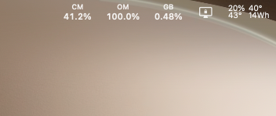
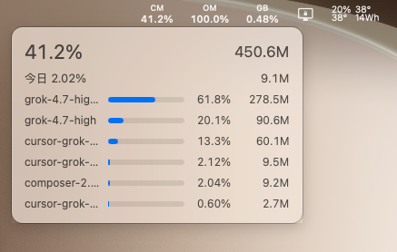
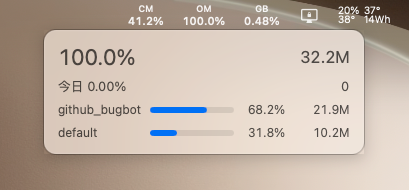
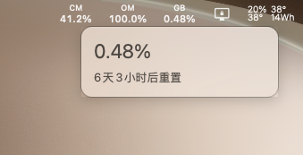
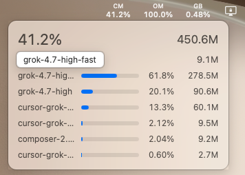

# CGBarStat

[English](README.en.md)

macOS 菜单栏应用。三个状态项从左到右显示 Cursor Models（CM）、Other Models（OM）和 Grok Bot（GB）。每一项上行是简拼，下行是用量百分比。百分比绝对值达到 10 时保留 1 位小数，不足 10 时保留 2 位小数。

## 下载

当前版本是 [0.2.0](https://github.com/Yeyue56/cgbarstat/releases/tag/v0.2.0)，适用于 macOS 14 及以上的 Apple 芯片 Mac。

[下载 CGBarStat-0.2.0-arm64.zip](https://github.com/Yeyue56/cgbarstat/releases/download/v0.2.0/CGBarStat-0.2.0-arm64.zip)

其余版本在 [Releases](https://github.com/Yeyue56/cgbarstat/releases)。

下载后解压得到 `CGBarStat.app`。当前构建没有 Apple 公证。首次打开时，在 Finder 里按住 Control 点按应用，再选择「打开」。macOS 26 及更新版本要在「系统设置 → 菜单栏」中允许 CGBarStat 显示状态项。应用不出现在 Dock。使用前本机需已安装并登录 Cursor。

## 界面

菜单栏从左到右是 CM、OM、GB。下图中这三项是 CGBarStat。



悬停 CM 打开 Cursor Models。第一行是额度百分比和本期 Tokens，第二行是今日 Tokens 占本期 Tokens 的比例和今日 Tokens，之后每行是一个模型的进度条、占比和 Tokens。模型列表下方是距离套餐到期的时间：达到一天时为天和小时，不足一天时为小时和分钟，后面加上「后过期」。已经到期时显示「套餐已过期」。响应里没有周期结束时间时不显示这一行。



悬停 OM 打开 Other Models，版式与 CM 相同。模型名在忽略大小写后包含 `composer`、`grok` 或 `cursor`，或者等于 `auto`、以 `auto-` 开头时归入 CM，其余归入 OM。图中的 `github_bugbot` 和 `default` 因此显示在 OM。



悬停 GB 打开 Grok Bot。悬浮窗只有百分比和距离下次重置的时间。达到一天时显示天和小时，后面加上「后重置」。



模型名超出宽度时尾部省略。悬停被省略的名称会显示完整名称。模型行的占比和 Tokens 分列显示，占比包含 `100.0%` 时仍在同一行。



## 环境

- macOS 14 或更新版本
- Apple 芯片
- 本机已安装并登录 Cursor

## 构建与运行

从源码构建需要 Swift 6 工具链。

```bash
swift test
scripts/package-app.sh
open CGBarStat.app
```

`scripts/package-app.sh` 在项目根目录生成 `CGBarStat.app`。可执行文件是 `CGBarStat.app/Contents/MacOS/CGBarStatApp`。应用包按当前机器的架构编译。仓库不收录应用包和 zip，打包文件发布在 [Releases](https://github.com/Yeyue56/cgbarstat/releases)。

## 数据来源

应用用只读方式打开：

`~/Library/Application Support/Cursor/User/globalStorage/state.vscdb`

从 `ItemTable` 读取 `cursorAuth/accessToken`、`cursorAuth/refreshToken`，以及套餐用户标识 `cursorAuth/stripeMembershipAuthId`。Cursor 3.27 起，access token 和 refresh token 会以 `cursor-safe-storage:v1:` 前缀加密保存。应用用登录钥匙串中的 `Cursor Safe Storage` / `Cursor Key` 在内存中解密。系统弹出的密码是「登录」钥匙串的密码，即这台 Mac 的登录密码。登录密码若曾更改，钥匙串可能仍使用更改前的密码。口令只保存在本次运行的内存中，因此同一次打开只询问一次。选择「始终允许」后，以后打开也不再询问。本地解开的明文留在内存中，数据库、快照、日志和仓库都不保存这份明文。只有服务器换发新令牌时，才把新值写回原来的两个键。

`api2.cursor.sh` 拒绝这个 access token 时，先用套餐用户标识和 access token 组成 `WorkosCursorSessionToken`，请求 `https://cursor.com/api/dashboard/get-current-period-usage`。仪表盘也拒绝时，再用 refresh token 向 `https://api2.cursor.sh/oauth/token` 换发，并写回上述两个键。用量请求只发往 `api2.cursor.sh`、`cursor.com` 和 `www.cursor.com`。自动重定向一律拒绝；只有这三台主机上的 HTTPS 重定向会再请求一次。

用量来自 `api2.cursor.sh` 上的：

- `DashboardService/GetCurrentPeriodUsage`：`autoPercentUsed`、`apiPercentUsed`，以及 `billingCycleEnd`
- `DashboardService/GetPlanInfo`：用量接口拒绝时读取 `planInfo.billingCycleEnd`
- `DashboardService/GetAggregatedUsageEvents`：本期与今日的模型 Tokens
- `DashboardService/GetSandUsageStatus`：Grok Bot 的 `usagePercent` 与 `nextResetTimestampUtc`

`api2.cursor.sh` 拒绝 access token 时，同一份周期用量改从 `cursor.com` 的 `api/dashboard/get-current-period-usage` 读取。字段与上面的周期用量相同。

这些接口没有公开兼容保证。没有重置时间戳时，界面显示「重置时间未知」，不用周期起点推算 7 天。

## 状态栏与悬浮窗

状态项按 GB、OM、CM 的顺序创建，使视觉顺序从左到右为 CM、OM、GB。版式见上文界面一节。不足一天时重置时间是小时和分钟，达到一天时是天和小时。没有重置时间戳时显示「重置时间未知」。CM 和 OM 悬浮窗用同一套计时显示套餐到期时间，已经到期时显示「套餐已过期」。本机没有 Cursor 登录时，悬浮窗显示「未检测到本机 Cursor 登录」。令牌已加密但钥匙串尚未允许读取时，显示「本机 Cursor 登录已加密。请允许 CGBarStat 读取钥匙串项 “Cursor Safe Storage”，允许后会自动刷新。」。保存的 access token 和 refresh token 都被拒绝时，显示「本机保存的登录仍被服务器拒绝。请完全退出 Cursor，再从账号菜单退出并重新登录。」，不再把上一份用量标成「数据已过期」。已经登录但这次没有拿到用量时，保留上一份数据并标明「数据已过期」；没有上一份数据时显示「用量暂时无法更新」。

## 刷新

应用启动、每 300 秒、系统唤醒时刷新。钥匙串尚未允许读取时仍按 300 秒刷新，以免反复弹出系统询问。保存的登录被服务器拒绝时改为每 15 秒重试，Cursor 重新登录写入新令牌后不必退出本应用。面板从隐藏变为显示时，若距离上次成功超过 30 秒，再刷新一次。

## 社区

[LINUX DO](https://linux.do)

## 许可证

本仓库使用 [MIT 许可证](LICENSE)。保留版权声明和许可证文本即可使用、修改和再分发，包括用于闭源软件。软件按原样提供，作者不承担担保责任。
